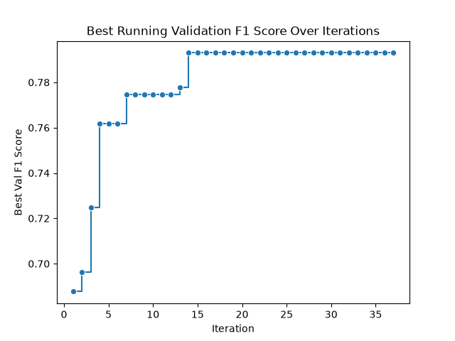

## LLM Feedback loop for Neural Architecture Search

I wanted to test a simple dual-agent feedback loop to see how it can come up with an image model architecture suited for the EuroSAT dataset(satellite image land cover classification) **while being under 20k parameters**.

- One agent is the brainstormer: it thinks of architectures to try out. It can access three tools:
    - `submit_experiment`: submit an architecture to be trained, which will also be stored in a database
    - `list_existing_experiments`: list first n experiments in the database
    - `search_existing_experiments`: search the experiment database via keywords

- The other agent is the analyzer: it receives the training results of the brainstormer's architecture, and provides feedback and directions

Current best model acheives 85.5% accuracy; accuracy could be further improved via longer epochs, augmentation, lr, training strategy.

Best model architecture, weights, and results are in `models/`.

Optimizers, lr, weight decay, augmentation are currently fixed; the loop optimizes with these constraints.